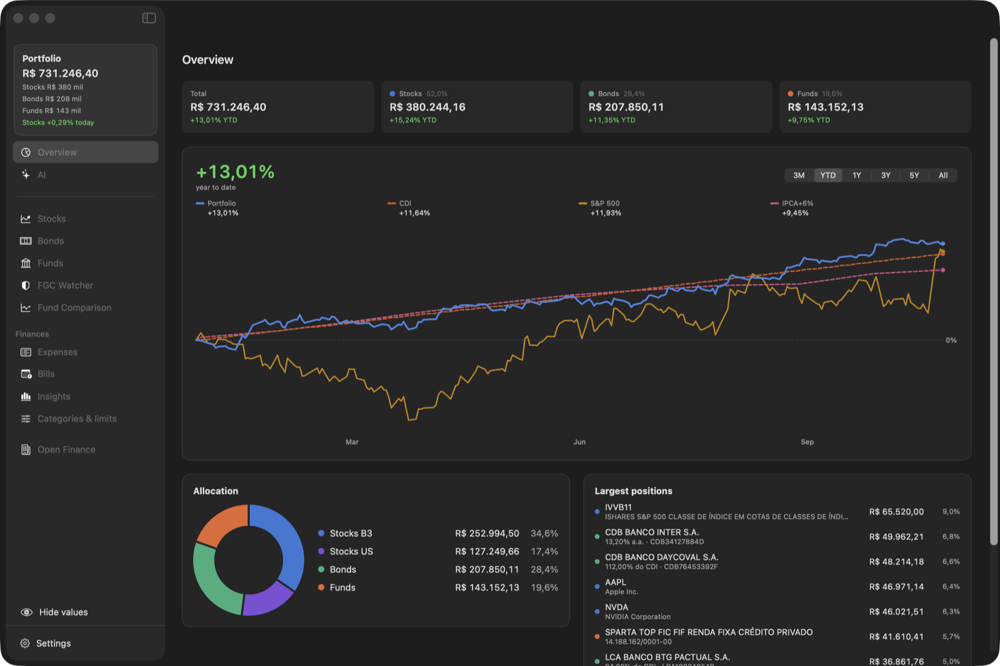
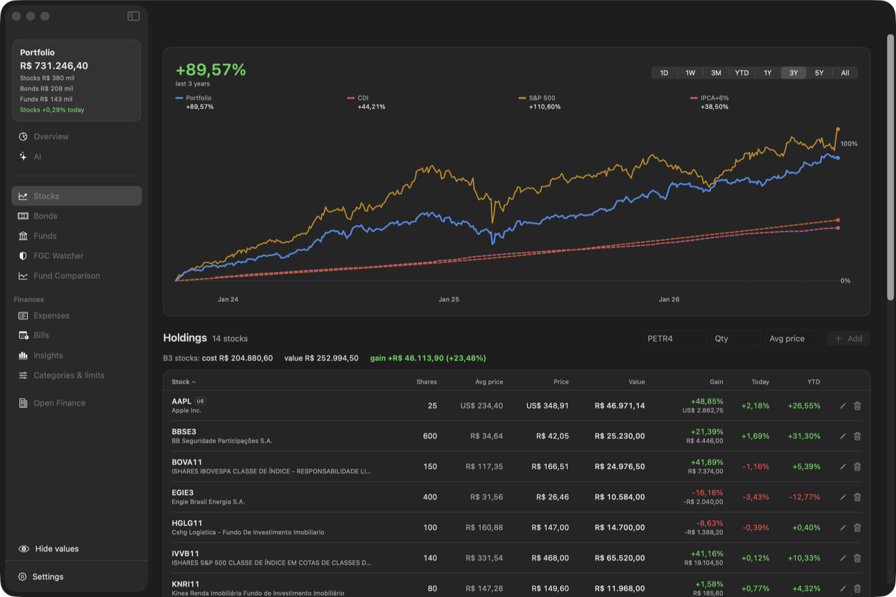
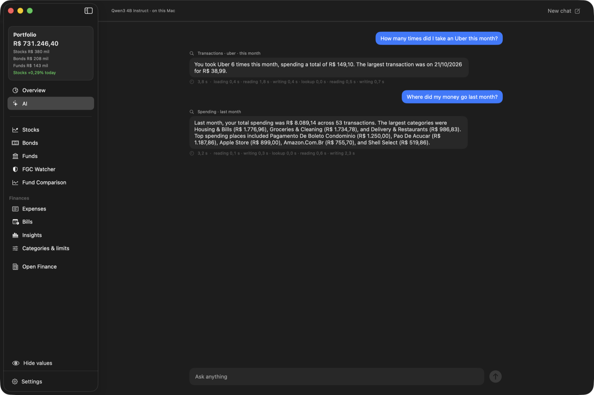
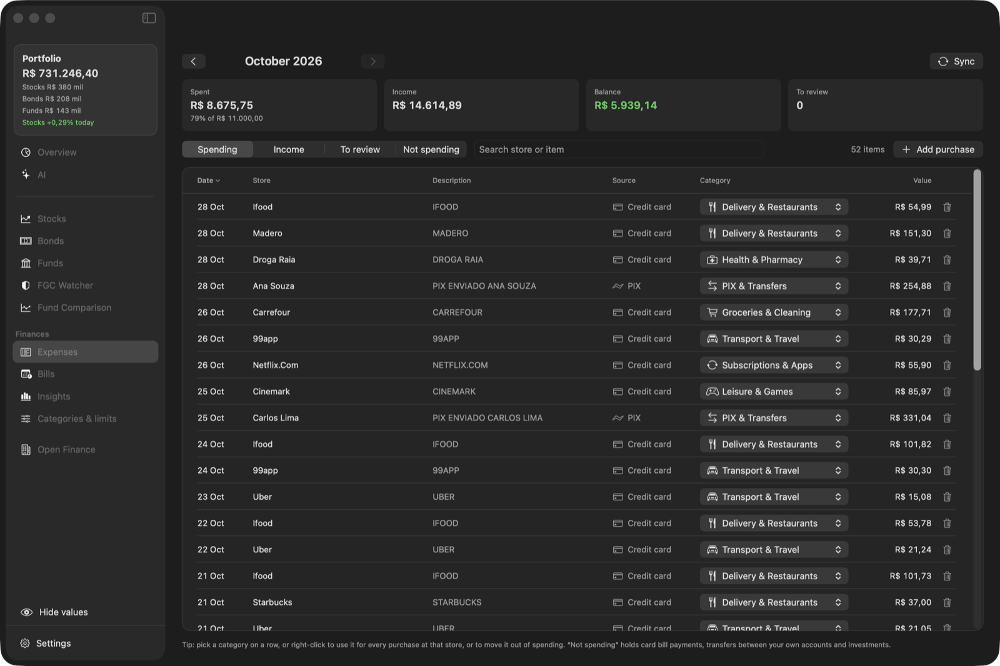
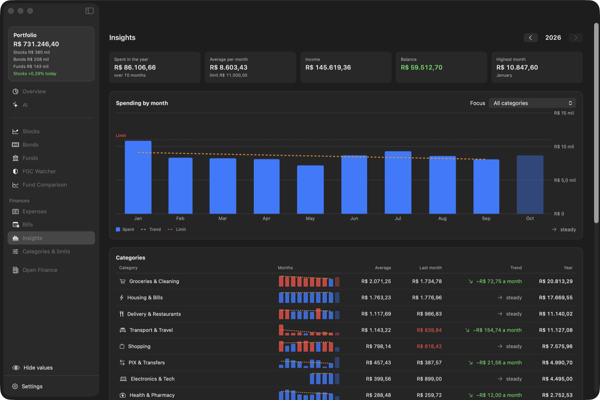
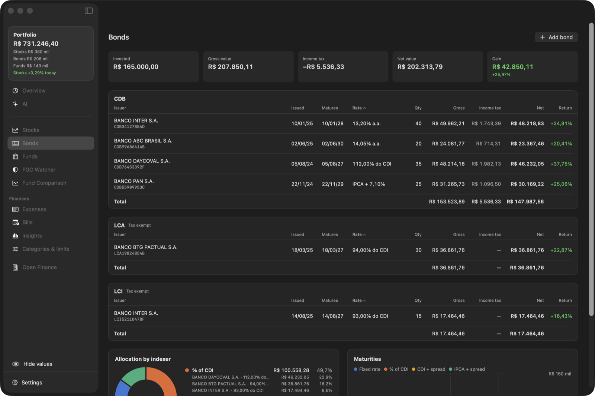
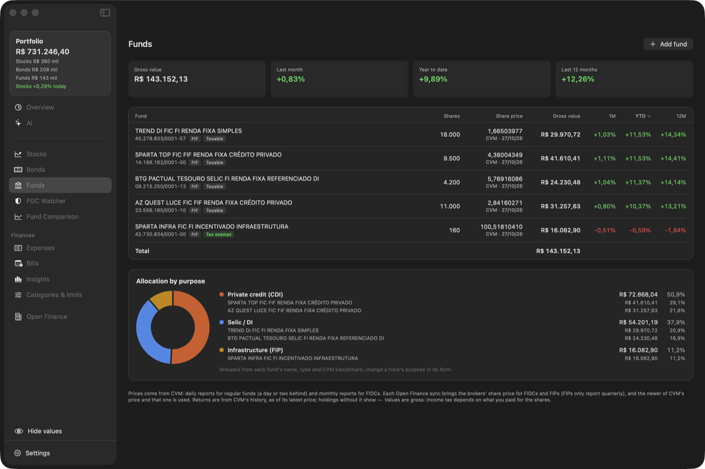
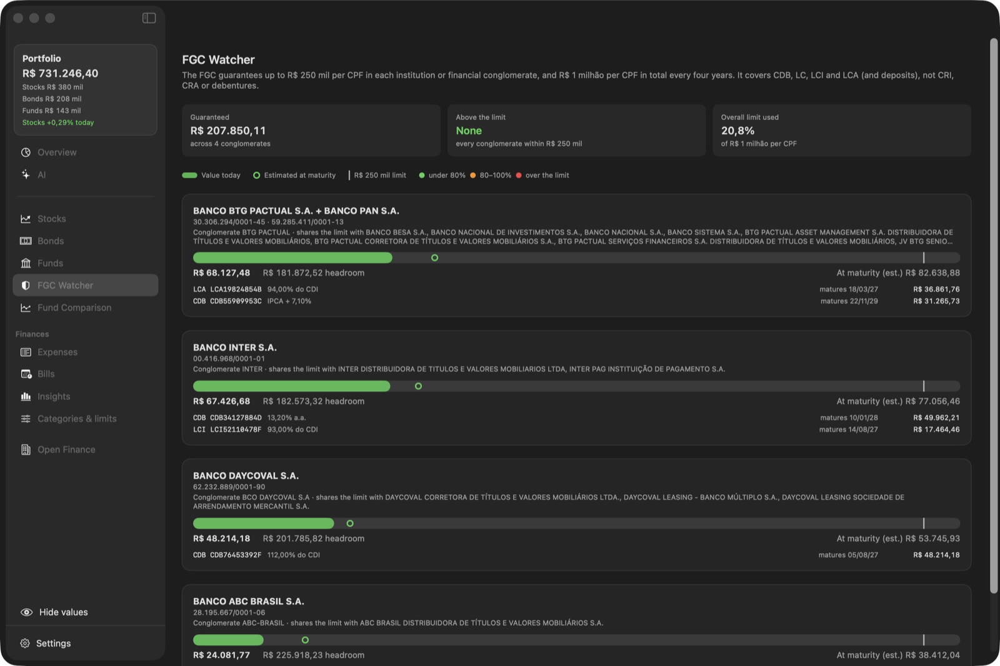
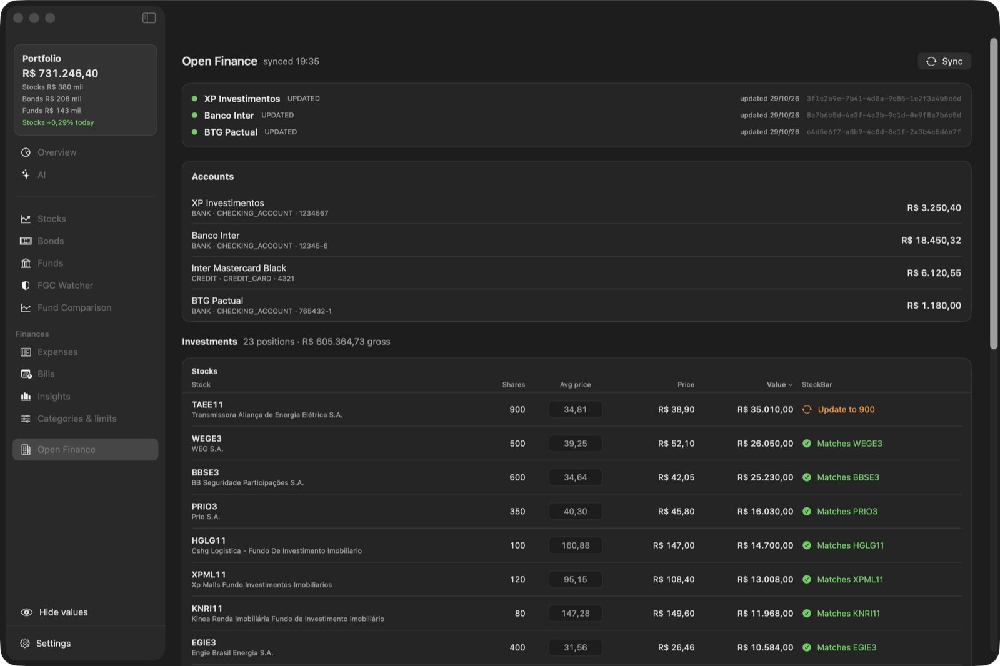

# StockBar

A native macOS app made with SwiftUI that tracks a Brazilian investment portfolio — stocks (B3 and US),
bonds and funds — against CDI, IPCA, IPCA+6%, the S&P 500, IFIX and IBOV. It opens as a window, with a
menu bar widget for a quick look. It also follows your spending through Open Finance, and you can ask it
about all of it in plain words.



<table>
  <tr>
    <td></td>
    <td></td>
  </tr>
  <tr>
    <td align="center">Stocks: performance against benchmarks, holdings with average price and gain</td>
    <td align="center">AI: ask about your money; it shows what it looked up</td>
  </tr>
  <tr>
    <td></td>
    <td></td>
  </tr>
  <tr>
    <td align="center">Expenses: every transaction of the month, categorized</td>
    <td align="center">Insights: the year month by month, with trends per category</td>
  </tr>
  <tr>
    <td></td>
    <td></td>
  </tr>
  <tr>
    <td align="center">Bonds: valued from their terms, with income tax</td>
    <td align="center">Funds: CVM share prices and allocation by purpose</td>
  </tr>
  <tr>
    <td></td>
    <td></td>
  </tr>
  <tr>
    <td align="center">FGC Watcher: exposure per conglomerate against the R$ 250 mil limit</td>
    <td align="center">Open Finance: your banks' positions, checked against what StockBar tracks</td>
  </tr>
</table>

<sub>Screenshots use made-up data.</sub>

## Install

Download the latest `StockBar-<version>.dmg` from [Releases](../../releases), open it and drag StockBar to Applications.
The app isn't notarized yet: on first launch, allow it in **System Settings → Privacy & Security → Open Anyway**.
Requires macOS 15+ (Apple Silicon or Intel).

After that, StockBar updates itself: it checks GitHub every few hours and shows **Update to …** in the sidebar;
one click downloads the new version, checks it's signed with the same certificate, replaces the app and relaunches.
Settings → Updates has "Check now" and a switch for beta versions.

## What's in it

- **Overview** — the whole portfolio: value by asset class, allocation (B3 stocks, US stocks, bonds, funds),
  largest positions, and one return curve for everything against the benchmarks (3M to 5Y, or All).
- **Stocks** — the performance chart (drag across it to measure a period), holdings with quantity and average
  price, and this year's dividends and JCP with a monthly chart.
- **Bonds** — CDBs, LCAs and other fixed income valued from their terms, with income tax, allocation by indexer
  and maturities.
- **Funds** — fund holdings at CVM's latest share price, returns, and allocation by purpose (Selic, credit, inflation…);
  type a CNPJ and Autofill fills in the name, type, tax status and latest price from CVM.
- **FGC Watcher** — exposure per financial conglomerate against the FGC's R$ 250 mil per-institution limit and
  R$ 1 milhão overall, today and estimated at maturity.
- **Fund Comparison** — search CVM's ~26k funds by name, CNPJ or manager, compare up to six against CDI, and open
  a fact sheet for each.
- **Open Finance** — investments and accounts pulled through [Meu Pluggy](https://meu.pluggy.ai), checked against
  what StockBar tracks, and an importer: pick positions (or select all bonds and funds), type average prices inline,
  and import them together.
- **Expenses** — every card, account and PIX transaction of a month from Open Finance, sorted into categories
  (pick one per row, or always use it for a store), with income, "to review" and what isn't spending (card bill
  payments, own transfers, investments). Card installments count in the month they're billed, and purchases in
  another currency are converted at the bank's rate (or the day's rate from Yahoo).
- **Categories & limits** — monthly limits per category and in total, with notifications near and over them, plus
  alerts for large purchases.
- **Insights** — a year month by month: spending against the limit with a trendline, each category's trend, and a
  month-by-month grid.
- **Bills** — what's due and when: card bills from the bank, and recurring boletos, automatic debits and financing
  found in your accounts, with the due day estimated from past payments (or set by you) and what's late this month.
- **AI** — ask about your money in plain words ("quantas vezes andei de Uber este mês?", "quanto rendeu meu CDB
  pré-fixado?"). The assistant looks things up with StockBar's own queries and shows what it looked up under each
  answer. Pick the engine in Settings → AI: Apple Intelligence or a model you run in [Ollama](https://ollama.com)
  (StockBar lists the ones that can call its tools), both free and on your Mac, or your own OpenAI, Anthropic, DeepSeek or Google Gemini API key.
- **Menu bar widget** — today's chart and holdings, plus price alerts that send a notification when a ticker reaches a target.
- **Português e English** — the whole app is translated to Brazilian Portuguese; pick the language, and light, dark
  or system theme, in Settings → Appearance.
- **Hide values** — one click (or ⇧⌘H) masks every amount, quantity and account number, for sharing screenshots;
  percentages and charts stay.

## Repository

- `macOS/` — the app: a Swift package (`Package.swift`, `Sources/`, `Resources/`) and `build.sh`, which builds the
  `.app` and the DMG.
- `web/` — a Next.js app, just started.
- `docs/screenshots/` — the images in this README.

## Develop

The macOS app, from `macOS/`:

```sh
cd macOS
./build.sh            # universal build/StockBar.app
./build.sh --install  # copy to ~/Applications and launch
./build.sh --dmg      # package build/StockBar-<version>.dmg
swift scripts/make-icon.swift  # regenerate Resources/AppIcon.icns
```

## Release

Push a version tag and GitHub Actions builds the DMG and publishes the release:

```sh
git tag v2.0.0 && git push origin v2.0.0
```

A tag with a suffix (`v3.0.0-beta-1`) is published as a pre-release; the app itself shows the numeric part (3.0.0).

## How it works

Your data lives in `~/Library/Application Support/StockBar/` (`trades.json`, `bonds.json`, `fund-holdings.json`,
`alerts.json`, `expenses.json` for categories, limits and bill choices); downloaded market data and Open Finance
transactions is cached in `~/Library/Caches/StockBar/`.

- **Stocks** are a ticker, a quantity and an optional average price. The quantities you hold today define the portfolio:
  the curve holds them through the whole range, each session's return weighting stocks by their value at the previous close.
- **Prices** come from Yahoo Finance (`PETR4` → `PETR4.SA`), as adjusted closes so dividends, JCP and splits are included
  (total return). US stocks are converted at each day's USD/BRL. A market that hasn't traded today shows "—" for 1D.
- **Benchmarks**: CDI (series 12) and IPCA (series 433) from Banco Central's SGS API, cached and refreshed incrementally;
  IFIX history from B3; S&P 500 (total return) and IBOV from Yahoo.
- **Dividends** for B3 companies come from B3's announcements (dividend vs JCP, record and payment dates); FIIs and US
  stocks use Yahoo's ex-dividend events. Amounts are gross, for the quantity held today.
- **Bonds** are priced like banks mark them: business days over 252 with ANBIMA holidays; CDI compounded daily at the
  contracted share; IPCA stepped on the issue day's monthly anniversary with the latest index published before each
  period ends. Income tax follows the regressive table; LCA, LCI, CRI, CRA and incentivized debentures are exempt.
- **Funds** use CVM's open data: daily reports (informe diário) for regular funds, the monthly FIDC report for receivables
  funds, and the statement price for FIPs. The fund registry, fact sheets (lâmina) and daily reports also power Fund Comparison.
- **FGC Watcher** groups issuers by their prudential conglomerate in Banco Central's IF.data, since institutions of one
  conglomerate share a single limit.
- **Open Finance** uses your own (free) Pluggy application: paste its client ID and secret in Settings once (the
  secret is stored in the macOS Keychain), then **Connect a bank or broker** opens Pluggy Connect inside the app.
  Each MeuPluggy connection shares one institution; connecting the same one twice is deduplicated, and
  **Reconnect** renews a connection when Meu Pluggy's one-year consent lapses.

- **AI** answers through four read-only tools (search and total transactions, spending summary, portfolio overview,
  holdings), shared by every engine; the model never sees raw files, only what a tool returns. The rules it follows
  are in `macOS/Resources/AI/rules.md`. The local model runs in Ollama, through its OpenAI-compatible endpoint on
  localhost (the same tool-calling code as the cloud engines), with thinking turned off for models that think, and is
  unloaded when you leave the AI tab. With an API key, your question and what the
  tools return are sent to that provider; nothing else leaves the Mac.

## Signing

Builds are signed with a self-signed certificate ("StockBar Code Signing") when it's in the keychain, or in CI
from the `SIGNING_P12_BASE64` / `SIGNING_P12_PASSWORD` secrets; otherwise ad hoc. A stable signature lets macOS
remember "Always Allow" for the app's Keychain item across updates. The app isn't notarized.
